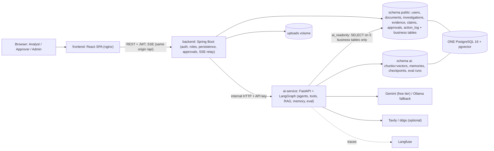
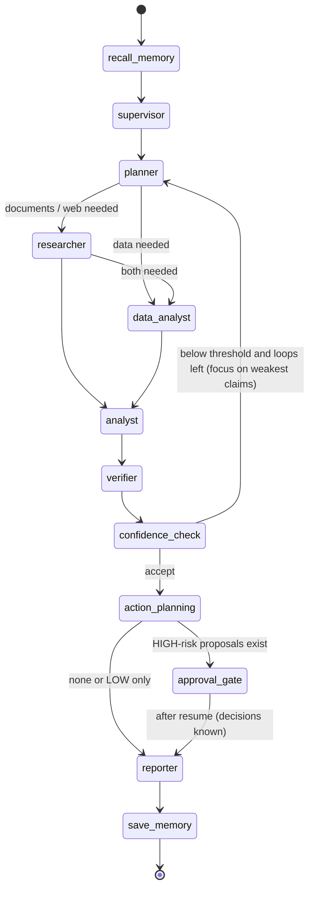
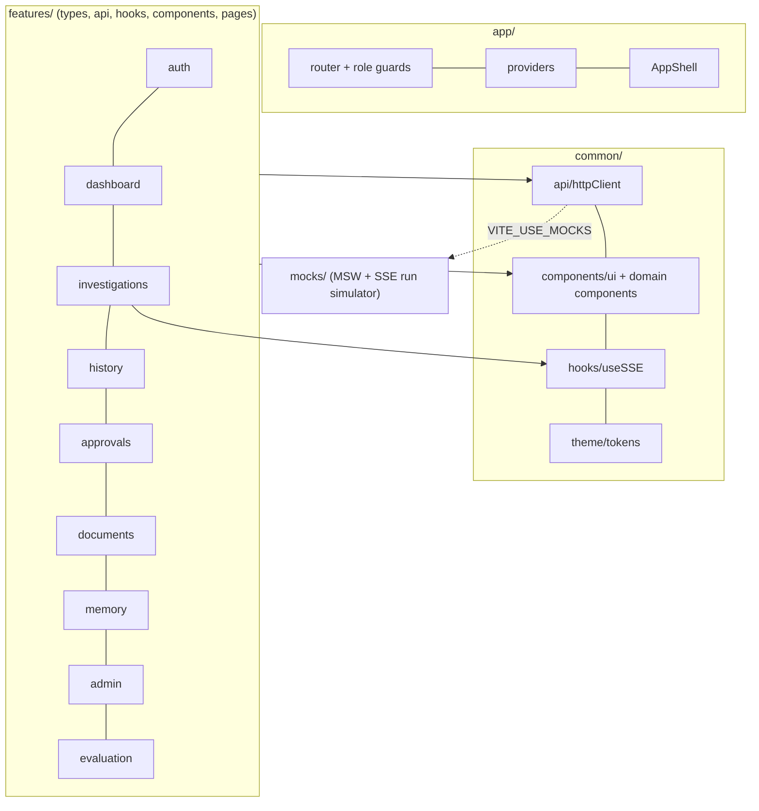
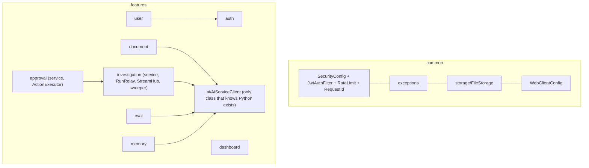
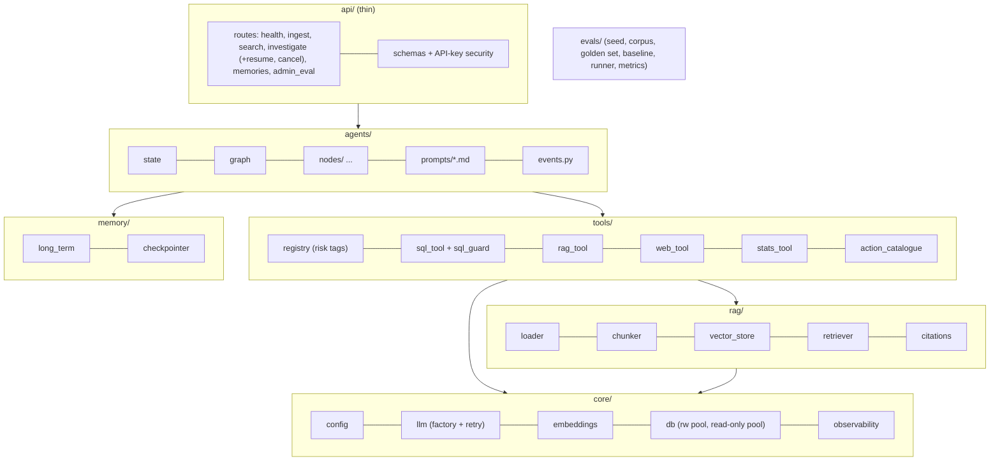
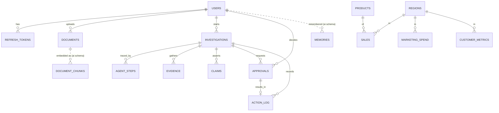

# NexusAI — System Architecture & Deep Dives (v2)

Levels: **1** system architecture; **2** component architecture (frontend, backend, AI service); **3** code structure (file 04). Mermaid diagrams render on GitHub.
Vocabulary: the repo is a **monorepo**; runtime is a **multi-service architecture** (React SPA, Spring Boot, Python); Spring Boot alone is a **modular monolith** (package-by-feature).

---

## 1. Level 1 — System architecture



### Rules
1. **Browser -> Spring only.** Python is internal (Docker `expose`, API key).
2. **Spring decides who may do what; Python decides how to think.** Spring owns identity, roles, state machine, approvals and action execution; Python owns reasoning, retrieval, memory and evaluation.
3. **The agent proposes, humans dispose.** Python cannot execute actions: it proposes from a fixed catalogue; LOW-risk ones are executed by Spring automatically, HIGH-risk ones by Spring only after a stored APPROVE. Execution is simulated and logged.
4. **Database ownership.** Spring owns/migrates `public` (Flyway). Python owns `ai`. Python reaches business tables only through the read-only role. No FK across schemas, so cross-schema deletes are application-level with a retry path.
5. **Runs are decoupled from browsers.** An investigation runs in the background, persists every event with a sequence number, and any browser can replay/resume the stream (`Last-Event-ID`).
6. **Organisation-wide knowledge base, per-user memory and investigations.**

## 2. Request flows

### 2.1 Investigation (core)
```mermaid
sequenceDiagram
  participant B as Browser
  participant S as Spring (InvestigationService + RunRelay)
  participant P as Python (LangGraph)
  participant D as Postgres
  B->>S: POST /api/investigations {question, options}
  S->>D: insert investigation (RUNNING, threadId)
  S-->>B: 202 InvestigationDTO
  B->>S: GET /{id}/stream (SSE, Last-Event-ID)
  S->>P: POST /internal/investigate (background virtual thread)
  loop events
    P-->>S: event (plan, tool_call, evidence_added, claim_verified, confidence, loop ...)
    S->>D: persist step (+evidence/claims), assign seq
    S-->>B: forward with id=seq
  end
  alt HIGH-risk action proposed
    P-->>S: approval_required (graph interrupt, state checkpointed)
    S->>D: approvals PENDING, status=AWAITING_APPROVAL
    Note over B,S: browser stream stays open (heartbeat)
    participant A as Approver browser
    A->>S: POST /approvals/{id}/decision
    S->>D: store decision; if all decided: execute approved actions (simulated), log
    S->>P: POST /internal/investigate/{threadId}/resume
    P-->>S: remaining events, report_ready, done
  end
  S->>D: status=COMPLETED, report, claims, confidence
  S-->>B: done (stream closes)
```

### 2.2 Ingestion
Spring validates (type, magic bytes, size, hash), stores via `FileStorage`, inserts `UPLOADED`, returns 202, and on a background thread calls Python `/internal/ingest` (multipart). Python: load -> clean -> chunk -> embed -> transactional upsert. Spring sets READY or FAILED (+reason). Sweepers repair stuck INGESTING and pending DELETING documents. UI polls only while something is in progress.

## 3. Agent graph (LangGraph)



**AgentState:** `question, userId, threadId, options, now, memories[], plan[], route, evidence[], claims[], verification[], overallConfidence, loop, maxLoops, focus[], proposedActions[], decisions[], report, summary, usage`.
**Node responsibilities** (each maps to a prompt file and emits its events):
| Node | Does | Notes |
|---|---|---|
| `recall_memory` | top-K past-investigation summaries for this user | relevance + recency + importance |
| `supervisor` | decides which specialists are needed and why | cheap, one call; trivial questions short-circuit |
| `planner` | question -> ordered sub-tasks with owning agent | on a loop, re-plans only the weak spots |
| `researcher` | tool-calling over `rag_search`, `web_search`, `recall_memory` | bounded tool calls, evidence with sources |
| `data_analyst` | tool-calling over `sql_query` + stats tools | numeric evidence (tables, series) |
| `analyst` | evidence -> discrete claims, key claims flagged | each claim cites evidence keys |
| `verifier` | claim vs cited evidence -> status + confidence (model in contract 9) | the anti-hallucination step |
| `confidence_check` | overall score vs threshold -> ACCEPT / LOOP / ACCEPT_LOW_CONFIDENCE | pure code, not LLM |
| `action_planning` | proposes catalogue actions (risk from catalogue) | LOW -> `action_proposed`; HIGH collected |
| `approval_gate` | emits `approval_required`, `interrupt()` | resumes from checkpoint |
| `reporter` | streams cited Markdown report incl. decisions | low-confidence banner if flagged |
| `save_memory` | embeds a short summary into `ai.memories` | skipped if `useMemory=false` |

Design decisions: verification and the confidence check are separate so the loop decision is deterministic and testable; the loop narrows its focus rather than redoing everything; the reporter only states claims that are VERIFIED (others appear in an explicit "unverified" section); dates/numbers come from tools, never from LLM arithmetic.

## 4. Component architecture — Frontend


- **State:** TanStack Query for server data; Zustand for auth (in memory) and UI flags; an `investigationRunStore` rebuilds the live view from events (plan, steps, evidence, claims, confidence history, loops, pending approvals) and can be fully rebuilt from `GET /steps` plus the stream.
- **Run screen:** three zones (plan | timeline | evidence + gauge) collapsing to tabs on mobile; milestones announced to a live region.
- **Why Vite SPA, not Next.js:** all behind login, no SEO; Spring is already the API; POST/GET SSE with auth header works with fetch-event-source; static build served by nginx; same-origin `/api` proxy keeps the refresh cookie simple.
- **Role-aware UI:** the nav, buttons and routes derive from `user.role`; the server remains the authority.

## 5. Component architecture — Backend


- **RunRelay:** one background task per run: calls Python, assigns `seq`, persists, publishes to the in-memory `StreamHub` (per-investigation replay + live sink). The browser endpoint = replay from DB after `seq`, then subscribe to the hub; this makes reconnects and multiple viewers trivial and keeps runs alive without browsers.
- **ActionExecutor:** validates action type/params against the catalogue, executes (simulated), writes `action_log`; the only place actions "happen".
- **ApprovalService:** role + self-approval checks; decision uses a conditional update (`WHERE status='PENDING'`) so races yield one winner; after the last decision triggers executor then resume.
- **Sweepers:** stuck INGESTING, pending DELETING, approval expiry, orphaned RUNNING at startup.
- **MVC + virtual threads** (blocking JPA, simple relay); `WebClient` only as an SSE/HTTP client.

## 6. Component architecture — AI service


- **Thin API, thick agents.** Routes validate, authenticate and stream; behaviour lives in `agents/`, `tools/`, `rag/`, `memory/`.
- **SQL safety stack (defence in depth):** AST validation (single SELECT, allow-listed tables, no dangerous functions) -> forced LIMIT -> read-only transaction + statement timeout -> a DB role that can only SELECT five tables. Violations are returned to the agent as tool errors so it can fix its query.
- **Tool registry:** every tool has schema, risk tag, allowed agents, timeout and call budget. Risk tags matter because the approval logic is driven by tags and catalogue, not by LLM judgement.
- **Resilience:** tenacity backoff for LLM 429/5xx; typed `LLM_RATE_LIMITED`; structured outputs validated with Pydantic (one repair retry, then deterministic fallback).
- **Evaluation:** `run_eval` runs the full agent and the baseline (single-shot RAG) on the golden set against the seeded company data.

## 7. Data architecture


Exact DDL: contract section 10. This diagram regenerates the report's Figure 3.

## 8. Security architecture (summary)
| Concern | Control |
|---|---|
| AuthN | BCrypt; 15-min access JWT in memory; rotating hashed refresh cookie with reuse detection; lockout |
| AuthZ | Roles in `SecurityConfig` + service-level visibility/ownership; 404 on foreign ids |
| Separation of duties | Self-approval forbidden; only APPROVER/ADMIN decide |
| High-risk control | Catalogue-defined risk; no execution without stored APPROVE; race-safe decision update; Spring (not Python) executes |
| Agent SQL | Read-only role + AST guard + allow-list + LIMIT + timeout; `users` and approvals unreachable |
| Prompt injection | Untrusted-data delimiting; agent has no write/exfiltration tools; adversarial tests |
| Internal trust | API key, constant-time compare, Python unpublished |
| Uploads | allow-list, magic bytes, size, random keys |
| Data egress | Free-tier LLM/web providers may log requests; only synthetic/non-sensitive data; Ollama profile for local-only; web search has a kill switch and sends only sub-task text |

## 9. Failure modes
| Failure | Expected behaviour |
|---|---|
| Python down at start | investigation -> FAILED with reason; user can start again |
| Python dies mid-run | relay marks FAILED (or, P2, resumes from checkpoint); partial trace kept |
| LLM 429 | backoff; then `LLM_RATE_LIMITED` error event, run FAILED with retry guidance |
| Browser closes | run continues; reload replays and tails |
| Spring restarts mid-run | orphaned RUNNING -> FAILED "interrupted by restart" at startup; AWAITING_APPROVAL runs keep their checkpoint and approvals and resume normally |
| Two approvers click | one succeeds, other gets `INVALID_STATE` |
| Approval never decided | TTL expiry -> EXPIRED, run completes noting no action taken |
| Agent writes bad SQL | guard rejects with reason; agent retries (bounded); otherwise evidence marked failed and claim confidence falls |
| Malformed LLM JSON | one repair retry, then fallback (e.g. treat claim as UNSUPPORTED) with warning logged |

## 10. Deployment
Default: Docker Compose with four services (postgres, ai-service, backend, frontend) plus optional `monitoring` and `ollama` profiles; same images on one VM. Free-tier hosting terms change: verify at deploy time (OPS-10).
